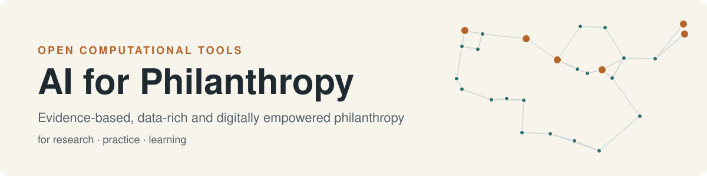

<picture>
  <source media="(prefers-color-scheme: dark)" srcset="https://raw.githubusercontent.com/AIforPhilanthropy/.github/main/profile/banner-dark.svg">
  
</picture>

**AI for Philanthropy** brings together, in one place, the computational tools we develop to support philanthropy research, practice and learning. Foundations, nonprofits and the scholars who study them hold a lot of evidence: campaign pages, annual reports, grant applications, programme data, beneficiary feedback. Most of it is never analysed systematically. The tools here turn that material into data you can analyse, and help people analyse it well. They combine conventional data science with machine learning and large language models.

Our aim is to advance **evidence-based, data-rich and digitally empowered philanthropy**.

| 🔬 Research | 🤝 Practice | 🎓 Learning |
|---|---|---|
| Reproducible pipelines for collecting, structuring and measuring philanthropic text and data. | Working tools that foundations and nonprofits can adapt to their own grantmaking, evaluation and reporting. | Teaching cases and notebooks that open in Google Colab and run with nothing to install. |

## Tools

Each tool can be used on its own. Some also link up: the campaign data gathered with **data_collection** feeds both **docling** and **RAG**.

| Stage | Repository | What it does | Start here |
|---|---|---|---|
| **Collect** | [data_collection](https://github.com/AIforPhilanthropy/data_collection) | Web scraping, demonstrated on Swiss Solidarity campaign pages. The notebook compares plain HTTP requests, BeautifulSoup, Selenium and agentic extraction with LLMs. | [Colab notebook](https://colab.research.google.com/github/AIforPhilanthropy/data_collection/blob/main/notebooks/web_scraping_swiss_solidarity_tutorial.ipynb) · [no-code scraper](https://huggingface.co/spaces/luciagomez/web_scraper) |
| **Structure** | [docling](https://github.com/AIforPhilanthropy/docling) | Turns campaign PDFs into Markdown with [Docling](https://github.com/docling-project/docling), then into a spreadsheet of campaign, crisis type, area and donations. | [README](https://github.com/AIforPhilanthropy/docling#readme) |
| **Retrieve & ask** | [RAG](https://github.com/AIforPhilanthropy/RAG) | Retrieval-augmented generation over campaign records: builds embeddings, gives grounded answers, benchmarks several LLMs with an LLM-as-judge, and tests the differences statistically. | [Embeddings](https://colab.research.google.com/github/AIforPhilanthropy/RAG/blob/main/campaign_embeddings_bert_mini.ipynb) · [Benchmark](https://colab.research.google.com/github/AIforPhilanthropy/RAG/blob/main/rag_llm_benchmark_judge.ipynb) |
| **Evaluate impact** | [AI4Phil_ImpactMeasurement](https://github.com/AIforPhilanthropy/AI4Phil_ImpactMeasurement) | An impact-measurement agent for a nonprofit programme. It covers financial sustainability, learning outcomes, satisfaction and reputation, and NLP on participant feedback, answering eight evaluation questions with notebooks and a ReAct agent. | [Colab notebook](https://colab.research.google.com/github/AIforPhilanthropy/AI4Phil_ImpactMeasurement/blob/main/nb_colab_01_financial_sustainability.ipynb) |
| **Decide & allocate** | [eduall](https://github.com/AIforPhilanthropy/eduall) | A grant-allocation teaching case: 500 synthetic applicants and CHF 500,000 to distribute. It compares data exploration, traditional machine learning and an LLM workflow. | [Notebooks](https://github.com/AIforPhilanthropy/eduall#notebooks) |

## Principles

- **Open and reproducible.** We publish the code, the sample data and the outputs together, so the results can be checked and rerun.
- **Accessible.** Notebooks open in Google Colab, and where we can we provide a no-code interface.
- **Human judgement first.** AI supports the decisions and interpretations that people in philanthropy make; it does not replace them.
- **Responsible data.** Teaching cases use synthetic or publicly available data.

## Get involved

Use, adapt and cite the tools. If you have a question or an idea, or you find a problem, open an issue in the relevant repository.
